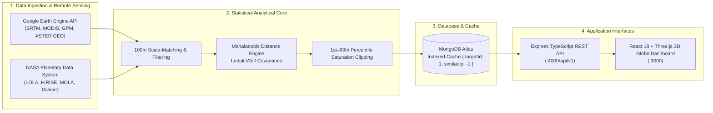

# ORBiALOG — Orbital to Terrestrial Planetary Analog Discovery Engine

[](https://www.spaceappschallenge.org/)
[](https://opensource.org/licenses/MIT)
[](https://www.typescriptlang.org/)
[](https://earthengine.google.com/)
[](https://react.dev/)

> **NASA Space Apps Challenge 2026 Submission**  
> *Challenge:* What's on the Horizon? Identifying and Analyzing Planetary Analog Sites

---

## 🌌 Executive Summary

**ORBiALOG** is a scientific remote sensing pipeline and full-stack spatial intelligence platform that matches exploration zones on the **Moon** and **Mars** to terrestrial Earth analog locations using **10 physical and spectral remote-sensing dimensions**.

Instead of relying on visual guesswork or textbook sites (e.g. Hawaii, Atacama), ORBiALOG extracts scale-matched digital elevation models, diurnal thermal inertia, shortwave albedo, and thermal infrared mineral emissivity indices from orbital satellite missions. It scores 11,466 global 1° terrestrial tiles using **Mahalanobis distance with Ledoit-Wolf shrinkage covariance** to discover previously understudied planetary analog candidates.

---

## 🏛️ System Architecture



---

## 🛰️ Space Agency Datasets Used

### Earth Observation Datasets (via Google Earth Engine & NASA Earthdata Cloud)
| Dimension | Sensor / Platform | Dataset Identifier | Spatial Resolution |
| :--- | :--- | :--- | :--- |
| **Slope & Relief** | Shuttle Radar Topography Mission | `USGS/SRTMGL1_003` | 30 m / px |
| **RMS Terrain Roughness** | SRTM 3×3 Local Uniform Residual Filter | Derived Metric | 100 m resampled |
| **Thermal Diurnal Delta** | Terra/Aqua MODIS Land Surface Temperature | `MODIS/061/MOD11A2` | 1 km / 8-day composite |
| **Peak Land Surface Temp** | MODIS Max Daytime LST | `MODIS/061/MOD11A2` | 1 km composite |
| **Surface Albedo** | MODIS Shortwave White-Sky Albedo | `MODIS/061/MCD43A3` | 500 m / 16-day |
| **Aridity / Precipitation** | Global Precipitation Measurement (GPM) | `NASA/GPM_L3/IMERG_MONTHLY_V06` | 0.1° / monthly |
| **Vegetation / Biome Index**| MODIS Normalized Difference Veg (NDVI) | `MODIS/061/MOD13A1` | 500 m / 16-day |
| **Mafic Mineral Proxy** | ASTER Global Emissivity Dataset (B12/B13) | `NASA/ASTER_GED/AG100_003` | 100 m / px |
| **Carbonate Mineral Proxy** | ASTER GED (B13/B14 emissivity ratio) | `NASA/ASTER_GED/AG100_003` | 100 m / px |
| **Quartz Silica Proxy** | ASTER GED ($B11^2 / (B10 \times B12)$) | `NASA/ASTER_GED/AG100_003` | 100 m / px |

### Extraterrestrial Target Telemetry (via NASA PDS Geosciences)
- **Moon:** Lunar Reconnaissance Orbiter (LRO) LOLA GDR Elevation Models (20 m/px) & Diviner Thermal Radiometer Polar Cold-Trap Catalog.
- **Mars:** Mars Reconnaissance Orbiter (MRO) HiRISE DTMs, Mars Global Surveyor (MGS) MOLA Topography, and CRISM Targeted Hyperspectral Observations.

---

## 🔬 Mathematical Methodology

### 1. Scale-Matching
Slope and surface roughness vary non-linearly with measurement grid scale. All elevation models (SRTM, LOLA, MOLA) are standardized to a ~100 m baseline before computing slope gradients:
$$\nabla z = \left( \frac{\partial z}{\partial x}, \frac{\partial z}{\partial y} \right), \quad \text{Slope} = \arctan\left(\sqrt{g_x^2 + g_y^2}\right)$$
$$\text{Roughness}_{\text{RMS}} = \sqrt{\frac{1}{N} \sum_{i=1}^N (z_i - \bar{z}_{3\times3})^2}$$

### 2. Mahalanobis Distance with Ledoit-Wolf Shrinkage
Because environmental variables correlate (e.g. hyper-aridity, high daytime temperatures, and low vegetation frequently co-occur), standard Euclidean distance counts the same physical conditions multiple times. 

ORBiALOG uses **Mahalanobis Distance** scaled by Earth's covariance structure $\mathbf{\Sigma}$:
$$d^2(\mathbf{x}, \mathbf{t}) = (\mathbf{x} - \mathbf{t})^T \mathbf{\Sigma}_{\text{LW}}^{-1} (\mathbf{x} - \mathbf{t})$$
$$S(\mathbf{x}, \mathbf{t}) = 100 \times \exp\left(-\frac{1}{2} \cdot \frac{d^2(\mathbf{x}, \mathbf{t})}{N_{\text{features}}}\right)$$

Where $\mathbf{\Sigma}_{\text{LW}}$ is computed using the **Ledoit-Wolf shrinkage estimator**, ensuring mathematical stability even across high-dimensional feature spaces.

---

## 🏆 Key Discoveries: 2 Novel Planetary Analogs

Running the detector across **11,466 global tiles** (excluding famous textbook sites within 150 km) identified two exceptional analog environments:

### 1. Mars Paleolake & Yardang Winner: Dasht-e Lut Basin, Iran $[31.5^\circ\text{N}, 60.5^\circ\text{E}]$
- **Similarity Score:** **93.7%**
- **Planetary Analog Context:** Replicates the wind-sculpted yardang corridors of **Gale Crater** and **Medusae Fossae**. Features Earth's highest recorded land surface temperature (MODIS $LST_{max} > 70.7^\circ\text{C}$) and near-zero precipitation ($<5\text{ mm/yr}$).
- **Mission Application:** Duricrust break-through tests, autonomous rover navigation through high-albedo glare, and wheel sinkage mechanics in abrasive silt.

### 2. Moon Basalt & Volcanic Tube Winner: Harrat Khaybar Volcanic Field, Saudi Arabia $[25.5^\circ\text{N}, 39.5^\circ\text{E}]$
- **Similarity Score:** **89.0%**
- **Planetary Analog Context:** Replicates **Mare Tranquillitatis** lunar basalt sheets. Features extensive alkali basalt flows and the **Umm Jirsan** subterranean lava tube system, representing natural architectural analogs for radiation-shielded lunar habitats.
- **Mission Application:** Autonomous 3D LiDAR mapping of subterranean caverns in GPS-denied environments; core sample retention in dense basalt.

---

## 🚀 Quickstart & Setup

### Prerequisites
- Node.js >= 18
- Python >= 3.10
- MongoDB Atlas account (or local MongoDB)

### 1. Repository Setup
```bash
git clone https://github.com/Kamal3laa/orbialog-nasa.git
cd orbialog-nasa
```

### 2. Backend Setup
```bash
cd backend
npm install
npm run build
npm run dev
```
*API will be live on `http://localhost:4000/api/v1`*

### 3. Frontend Dashboard Setup
```bash
cd ../frontend
npm install
npm run dev
```
*Dashboard will open on `http://localhost:3000`*

### 4. Running the Remote Sensing Detection Pipeline
```bash
cd ../pipeline
python3 -m venv .venv && source .venv/bin/activate
pip install -r requirements.txt
python merge_and_detect.py
```

---

## 📡 Core API Endpoints

- **`GET /api/v1/analogs?target=<targetId>&limit=<n>`** — Returns the top Earth analog matches matching the frontend JSON contract.
- **`GET /api/v1/analogs/targets`** — Lists available space target exploration sites.
- **`GET /api/v1/targets`** — Full planetary target profiles with telemetry.
- **`GET /api/v1/sites`** — Earth analog candidate sites with pagination, sorting, and category filters.
- **`GET /api/v1/comparison?target=<id>&analog=<id>`** — Head-to-head multi-dimensional fidelity comparison.
- **`POST /api/v1/sandbox/query`** — Subsystem telemetry stress simulation.
- **`GET /api/v1/health`** — Healthcheck and readiness monitoring.

---

## 🌐 Production Deployment

### Option A: Render (1-Click Blueprint)
The repository contains a [`render.yaml`](render.yaml) Blueprint that sets up both the Backend API and Frontend Static Site:
1. Log in to [Render](https://dashboard.render.com/).
2. Click **New +** $\rightarrow$ **Blueprint**.
3. Connect `Kamal3laa/orbialog-nasa`.
4. Set the `MONGODB_URI` environment variable when prompted (your MongoDB Atlas connection string).
5. Click **Apply** — Render deploys both services automatically.

### Option B: Docker Compose (Any VPS / Cloud)
```bash
docker compose up -d --build
```
*Frontend: `http://localhost:3000` | Backend API: `http://localhost:4000/api/v1`*

### Option C: Vercel (Frontend)
1. Import `Kamal3laa/orbialog-nasa` on [Vercel](https://vercel.com/).
2. Set root directory to `frontend`.
3. Set environment variable `VITE_API_URL` to your live deployed backend URL (e.g. `https://your-api.onrender.com/api/v1`).
4. Click **Deploy**.

---

## 👥 Team
- **ORBiALOG Team** — NASA Space Apps Challenge 2026
